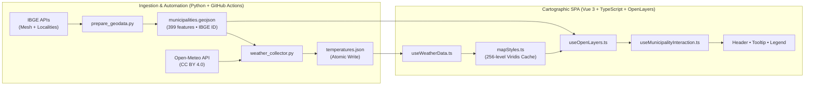

<div align="center">


# Pinhal

**Interactive weather map of all 399 municipalities of Paraná, Brazil**

[](https://github.com/andreysilveira/pinhal/actions/workflows/deploy-pages.yml)
[](https://github.com/andreysilveira/pinhal/actions/workflows/update-weather.yml)
[](./LICENSE)
[](#10-data-sources-and-documented-limitations)

[](https://vuejs.org/)
[](https://www.typescriptlang.org/)
[](https://openlayers.org/)
[](https://vite.dev/)
[](https://tailwindcss.com/)
[](https://www.python.org/)
[](https://servicodados.ibge.gov.br/)
[-F59E0B)](https://open-meteo.com/)

[Overview](#1-overview) •
[Features](#3-features) •
[Screenshots](#5-screenshots) •
[Installation](#7-installation) •
[Architecture](#9-architecture) •
[Data Sources](#10-data-sources-and-documented-limitations) •
[License](#14-license)

</div>

---


---

## 1. Overview

**Pinhal** is an open-source cartographic web application designed for fast, responsive, and accessible visualization of weather conditions across all **399 municipalities of the state of Paraná, Brazil**, built with **Vue 3**, **TypeScript**, and **OpenLayers**.

> [!NOTE]
> **Independent Implementation:** Pinhal is functionally inspired by the user experience of [Simepar Map](https://github.com/kauevestena/simepar_map) ([reference application](https://kauevestena.github.io/simepar_map/)), created by Kauê Vestena. All source code, OpenLayers cartographic architecture, and data ingestion pipelines in this repository were independently designed and developed from scratch, without copying proprietary code or datasets.

---

## 2. Project Goal

Deliver a predominantly cartographic interface — clean, fluid, and free of visual clutter — where the map serves as the central protagonist to explore the spatial distribution of temperatures across Paraná, adhering to rigorous geospatial standards, official IBGE identifiers, and automated data updates.

---

## 3. Features

| Feature | Description |
| :--- | :--- |
| **Interactive Map of Paraná** | Vector rendering of all **399 municipalities** with crisp boundary lines, smooth zoom, continuous panning, and automatic viewport-responsive framing. |
| **Scientific Viridis Choropleth** | Perceptually uniform continuous color scale (accessible for color-vision deficiencies), dynamically calculated from the minimum and maximum values of the active variable. |
| **Weather Variable Selector** | Instant switching — without reloading the map or resetting camera zoom/pan — between **Current Temperature**, **Maximum Temperature**, and **Minimum Temperature** (`°C`). |
| **Cartographic Hover (Desktop)** | Feature detection via OpenLayers `forEachFeatureAtPixel` with temporary dual-stroke halo highlighting, dynamic indicator marker on the legend bar, and edge-aware floating tooltip. |
| **Touch Interaction (Mobile)** | Touch-to-select interaction with bottom informational card, smooth updates when tapping another municipality, and explicit close button (`×`). |
| **Accessible Keyboard Search** | Municipality search combobox (`Buscar município...`) with full keyboard navigation (`↑`, `↓`, `Enter`, `Esc`), displaying temperatures and auto-centering selected municipalities without requiring mouse or color perception. |
| **Independent Basemaps** | Seamless switching between **Light Map** (high-contrast monochromatic basemap derived from OpenStreetMap) and standard full-color **OpenStreetMap**. |
| **Transparent State Handling** | Non-blocking visual status feedback for initial loading, up-to-date data, partial coverage, stale data, offline demo mode, or connectivity failures. |

---

## 4. Tech Stack

| Layer | Technologies | Role in the Project |
| :--- | :--- | :--- |
| **Frontend & UI** | Vue 3 (Composition API), TypeScript 6, Vite 8, Tailwind CSS 4, Lucide Vue Next | Minimalist reactive interface, strict typing with zero `any`, and accessible controls. |
| **Cartography & GIS** | OpenLayers (`ol` 10), GeoJSON (`FeatureCollection`), `EPSG:4326` / `EPSG:3857` | Municipal vector rendering, tile layers, metric scale bar, and spatial event handling. |
| **Data Pipeline** | Python 3.10+, `requests` / `urllib`, IBGE & Open-Meteo APIs | Official boundary preparation, batch weather collection, and atomic validated writes. |
| **Infrastructure** | GitHub Actions, GitHub Pages | Scheduled cron-based weather data ingestion, automated validation, and static hosting. |

---

## 5. Screenshots

| Desktop (`1440×900` — Municipality Hover) | Mobile (`390×844` — Compact Responsive Layout) |
| :---: | :---: |
|  |  |

---

## 6. Project Structure

```text
pinhal/
├── .github/
│   └── workflows/
│       ├── deploy-pages.yml              # Static build and deployment to GitHub Pages
│       └── update-weather.yml            # Scheduled weather collection + validation + deploy
├── docs/
│   └── screenshots/                      # Verified screenshots (desktop and mobile)
├── public/
│   ├── data/
│   │   ├── municipalities.geojson        # Official IBGE boundaries for 399 Paraná municipalities
│   │   └── temperatures.json             # Current, max, min temperatures and collection metadata
│   └── favicon.svg                       # Vector brand icon (Araucaria silhouette + Viridis gradient)
├── scripts/
│   ├── prepare_geodata.py                # Fetch, enrich, and validate official IBGE mesh GeoJSON
│   ├── weather_collector.py              # Batch Open-Meteo forecast collection with atomic write
│   └── requirements.txt                  # Python dependencies for automated CI runs
├── src/
│   ├── components/
│   │   ├── layout/
│   │   │   └── AppHeader.vue             # Floating header, metadata popover, and search combobox
│   │   ├── map/
│   │   │   ├── MapBaseSelector.vue       # Basemap selector (Light / OpenStreetMap)
│   │   │   ├── MapControls.vue           # Zoom in, Zoom out, and Reframe Paraná controls
│   │   │   ├── MapView.vue               # OpenLayers viewport, state banners, and overlays
│   │   │   ├── MunicipalityTooltip.vue   # Dynamic tooltip (hover) & bottom card (touch/search)
│   │   │   └── TemperatureLegend.vue     # Dynamic Viridis legend with live temperature marker
│   │   └── weather/
│   │       └── WeatherVariableSelector.vue # Current / Maximum / Minimum variable switcher
│   ├── composables/
│   │   ├── useMunicipalityInteraction.ts # Pointermove, singleclick, and keyboard focus interactions
│   │   ├── useOpenLayers.ts              # ol/Map lifecycle, projections, layers, and navigation
│   │   └── useWeatherData.ts             # Weather state, active scale domain, and data freshness
│   ├── constants/
│   │   └── mapConfig.ts                  # Paraná geographic bounds, projections, and layer definitions
│   ├── services/
│   │   └── weatherService.ts             # Resilient data fetching and defensive JSON validation
│   ├── types/
│   │   ├── geography.ts                  # Geographic interfaces and GeoJSON property models
│   │   └── weather.ts                    # Weather data models, metadata, and availability states
│   ├── utils/
│   │   ├── geoUtils.ts                   # Diacritic normalization, pt-BR formatting, and features
│   │   ├── mapStyles.ts                  # OpenLayers style factory with 256-level quantized cache
│   │   └── temperatureColors.ts          # Continuous Viridis interpolation and numerical helpers
│   ├── App.vue
│   ├── main.ts
│   └── style.css
├── .env.example
├── .gitignore
├── index.html
├── LICENSE
├── package.json
└── vite.config.ts
```

---

## 7. Installation

### Prerequisites
- **Node.js** `20.x` or higher and **npm** `10+`
- **Python** `3.10` or higher *(optional, only needed for running local data ingestion scripts)*

### Step-by-Step Setup

```bash
# 1. Clone the repository
git clone https://github.com/andreysilveira/pinhal.git
cd pinhal

# 2. Install frontend dependencies
npm install

# 3. (Optional) Install Python collector dependencies
pip install -r scripts/requirements.txt
```

> [!TIP]
> To configure optional build settings (such as `VITE_BASE_PATH`), copy [`.env.example`](./.env.example) to `.env` in the project root.

---

## 8. Local Execution

| Command | Action |
| :--- | :--- |
| `npm run dev` | Starts Vite development server with Hot Module Replacement (HMR). |
| `npm run typecheck` | Runs strict TypeScript type checking (`vue-tsc -b`). |
| `npm run build` | Builds and validates the optimized static production bundle in `dist/`. |
| `npm run preview` | Locally serves the generated production bundle from `dist/`. |
| `npm run prepare:geodata` | Rebuilds `public/data/municipalities.geojson` from official IBGE APIs. |
| `npm run collect:weather` | Fetches, validates, and updates real temperatures in `public/data/temperatures.json`. |

---

## 9. Architecture



### Key Performance and Quality Decisions
1. **Cartographic Decoupling:** The `ol/Map` instance and its underlying layers (`TileLayer` and `VectorLayer`) remain outside Vue's deep reactivity tree using `shallowRef`, preventing proxy overhead over complex geometries.
2. **Strict Association via IBGE Code (`municipalityId`):** Municipalities are mapped to weather records in `O(1)` time via a `Map<string, MunicipalityWeather>` keyed strictly on the 7-digit IBGE code (`4100103`–`4128807`), avoiding naming or accent discrepancies.
3. **Quantized Style Cache (`mapStyles.ts`):** Polygon fills are pre-quantized into 256 discrete bins of the Viridis color scale and cached in memory. Pointermove events, zooms, and variable toggles trigger zero repeated `Style` instantiations.
4. **Dedicated Highlight Layer (`highlightLayer`):** When hovering or tapping a municipality, only **1 feature** is pushed to an isolated high-contrast overlay layer, ensuring a fluid 60 FPS experience with all 399 base polygons undisturbed.

---

## 10. Data Sources and Documented Limitations

### Territorial Boundaries
- **IBGE — Instituto Brasileiro de Geografia e Estatística (`servicodados.ibge.gov.br`):**
  - *Malhas Territoriais v3* (`estados/41?intrarregiao=municipio&qualidade=intermediaria`): Official vector polygons for all 399 municipalities of Paraná.
  - *Localidades v1* & *Metadados v3*: Official nomenclature, immediate geographic regions, territorial areas (`km²`), and official centroids.

### Meteorological Data
- **Open-Meteo Weather Forecast API (`api.open-meteo.com/v1/forecast`):**
  - Open data licensed under **CC BY 4.0** for non-commercial and open-source use.
  - Integrates global and regional high-resolution Numerical Weather Prediction models (ECMWF IFS, NOAA GFS, DWD ICON, MeteoSwiss), providing 2-meter air temperature (`temperature_2m`, updated every 15 min) alongside daily maximum and minimum temperatures (`temperature_2m_max`, `temperature_2m_min`) in the `America/Sao_Paulo` timezone.
  - Efficient multi-coordinate batch requests allow updating all 399 municipal centroids in just 5 HTTP requests.

> [!IMPORTANT]
> **Investigated Limitations and Compliance:**
> - **Simepar:** Although functional inspiration for this project, Simepar does not provide an open, public, unauthenticated API for third-party automated consumption without a formal institutional agreement. In compliance with terms of service and engineering ethics, no unauthorized web scraping is performed.
> - **INMET (`apiprevmet3.inmet.gov.br`):** Exhibits connection reset issues during sequential scans of 399 municipalities and only provides period-based forecasts (morning/afternoon/night) on public municipal endpoints rather than real-time current temperatures.

---

## 11. Cartographic Attributions

- **Municipal Boundaries:** © [IBGE](https://www.ibge.gov.br/) — Instituto Brasileiro de Geografia e Estatística (Brazilian Government Open Data).
- **Basemaps:** © [OpenStreetMap](https://www.openstreetmap.org/copyright) contributors (ODbL).
- **Weather Data:** [Weather data by Open-Meteo.com](https://open-meteo.com/) under [CC BY 4.0](https://creativecommons.org/licenses/by/4.0/).
- **Mapping Engine:** [OpenLayers](https://openlayers.org/) (BSD 2-Clause License).
- **Functional Inspiration:** [Simepar Map](https://github.com/kauevestena/simepar_map) by Kauê Vestena.

---

## 12. Automated Update Pipeline

The [`.github/workflows/update-weather.yml`](./.github/workflows/update-weather.yml) workflow keeps weather data continuously updated:

1. **Configurable Schedule:** Runs automatically every 3 hours (`cron: '0 */3 * * *'`) or manually via `workflow_dispatch`.
2. **Strict Validation:** [`scripts/weather_collector.py`](./scripts/weather_collector.py) validates plausible physical ranges (`-35 °C` to `+55 °C`), numerical consistency (`min <= current <= max`), and minimum municipal coverage (`--min-valid 350`).
3. **Data Integrity Protection:** Employs atomic writes using temporary files (`.tmp`). If network failure or truncated data occurs, the existing valid `public/data/temperatures.json` **is never overwritten**, and error diagnostics are logged to the GitHub Actions job summary.
4. **Continuous Deployment:** Whenever validated updates are committed, the workflow triggers an updated static build and deployment to **GitHub Pages**.

*(For offline testing without internet connectivity, running `python scripts/weather_collector.py --demo` generates explicitly labeled synthetic data with `"isDemo": true` and `"status": "demo"`, clearly identified across the UI).*

---

## 13. Contributing

Contributions are welcome!

1. Fork the repository and create a feature branch (`git checkout -b feat/my-feature`).
2. Verify type safety (`npm run typecheck`) and ensure the production build passes (`npm run build`).
3. Strictly adhere to licensing, attribution, and terms of service of all geographic and weather providers.
4. Open a Pull Request detailing your changes.

---

## 14. License

Distributed under the **MIT License**. See [LICENSE](./LICENSE) for full text.

---

<div align="center">
  <sub>Built with Vue 3, TypeScript, and OpenLayers for open weather visualization in Paraná, Brazil.</sub>
</div>
