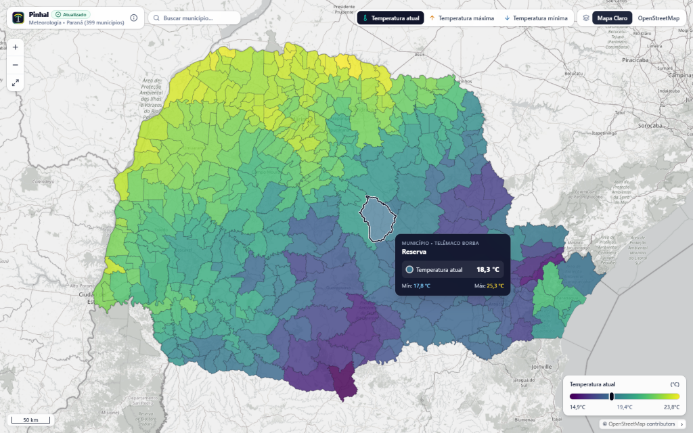
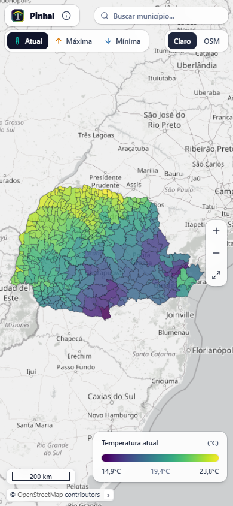
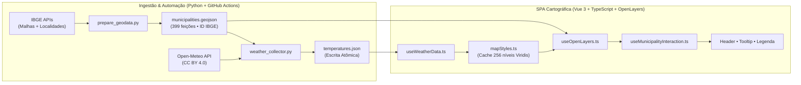

<div align="center">


# Pinhal

**Mapa meteorológico interativo dos 399 municípios do estado do Paraná, Brasil**

[](https://github.com/andreysilveira/pinhal/actions/workflows/deploy-pages.yml)
[](https://github.com/andreysilveira/pinhal/actions/workflows/update-weather.yml)
[](./LICENSE)
[](#10-fontes-dos-dados-e-limitações-documentadas)

[](https://vuejs.org/)
[](https://www.typescriptlang.org/)
[](https://openlayers.org/)
[](https://vite.dev/)
[](https://tailwindcss.com/)
[](https://www.python.org/)
[](https://servicodados.ibge.gov.br/)
[-F59E0B)](https://open-meteo.com/)

[Apresentação](#1-apresentação) •
[Funcionalidades](#3-funcionalidades) •
[Capturas de Tela](#5-capturas-de-tela) •
[Instalação](#7-instruções-de-instalação) •
[Arquitetura](#9-explicação-da-arquitetura) •
[Fontes de Dados](#10-fontes-dos-dados-e-limitações-documentadas) •
[Licença](#14-licença)

</div>

---



---

## 1. Apresentação

**Pinhal** é uma aplicação web cartográfica de código aberto voltada à visualização rápida, responsiva e acessível das condições térmicas dos **399 municípios do estado do Paraná**, desenvolvida com **Vue 3**, **TypeScript** e **OpenLayers**.

> [!NOTE]
> **Implementação independente:** O Pinhal é inspirado funcionalmente na experiência de uso do projeto [Simepar Map](https://github.com/kauevestena/simepar_map) ([aplicação de referência](https://kauevestena.github.io/simepar_map/)), criado por Kauê Vestena. Todo o código-fonte, arquitetura cartográfica em OpenLayers e pipeline de ingestão de dados deste repositório foram desenvolvidos de forma própria e independente, sem reutilização de código ou dados proprietários.

---

## 2. Objetivo do Projeto

Disponibilizar uma interface predominantemente cartográfica — limpa, fluida e livre de poluição visual — na qual o mapa seja o elemento central para explorar a distribuição espacial de temperaturas no Paraná, mantendo rigor técnico em projeções geográficas, associação por identificador oficial do IBGE e atualização automatizada.

---

## 3. Funcionalidades

| Recurso | Descrição |
| :--- | :--- |
| **Mapa Interativo do Paraná** | Renderização vetorial dos **399 municípios** com divisões nítidas, zoom suave, movimentação contínua (*pan*) e enquadramento inicial automático adaptado à tela. |
| **Coroplético Científico Viridis** | Escala contínua perceptualmente uniforme (acessível para daltônicos), recalculada dinamicamente a partir dos valores mínimo e máximo da variável ativa. |
| **Seleção de Variável Meteorológica** | Alternância instantânea — sem recarregar o mapa ou perder o zoom — entre **Temperatura atual**, **Temperatura máxima** e **Temperatura mínima** (`°C`). |
| **Hover Cartográfico (Desktop)** | Detecção via `forEachFeatureAtPixel` com destaque temporário em halo duplo, marcador dinâmico na legenda e *tooltip* flutuante próximo ao cursor. |
| **Interação por Toque (Mobile)** | Seleção por toque com cartão informativo inferior, atualização ao tocar em outro município e fechamento explícito (`×`). |
| **Busca Acessível por Teclado** | Combobox de busca municipal (`Buscar município...`) com navegação via teclado (`↑`, `↓`, `Enter`, `Esc`), exibindo temperaturas e centralizando o município selecionado. |
| **Mapas-Base Independentes** | Alternância entre **Mapa Claro** (monocromático de alto contraste derivado do OpenStreetMap) e **OpenStreetMap** colorido padrão. |
| **Tratamento Transparente de Estados** | Sinalização visual não bloqueante para carregamento inicial, dados atualizados, cobertura parcial, dados desatualizados, modo demonstração ou indisponibilidade. |

---

## 4. Tecnologias Utilizadas

| Camada | Tecnologias | Papel no Projeto |
| :--- | :--- | :--- |
| **Frontend & UI** | Vue 3 (Composition API), TypeScript 6, Vite 8, Tailwind CSS 4, Lucide Vue Next | Interface reativa minimalista, tipagem estrita sem `any` e controles acessíveis. |
| **Cartografia & GIS** | OpenLayers (`ol` 10), GeoJSON (`FeatureCollection`), `EPSG:4326` / `EPSG:3857` | Renderização vetorial municipal, camadas de *tiles*, escala gráfica métrica e eventos espaciais. |
| **Pipeline de Dados** | Python 3.10+, `requests` / `urllib`, APIs IBGE & Open-Meteo | Construção da malha oficial e coleta meteorológica validada com escrita atômica. |
| **Infraestrutura** | GitHub Actions, GitHub Pages | Coleta periódica agendada via *cron*, validação automatizada e publicação estática. |

---

## 5. Capturas de Tela

| Desktop (`1440×900` — Hover sobre município) | Mobile (`390×844` — Layout compacto responsivo) |
| :---: | :---: |
|  |  |

---

## 6. Estrutura do Projeto

```text
pinhal/
├── .github/
│   └── workflows/
│       ├── deploy-pages.yml              # Build estático e publicação no GitHub Pages
│       └── update-weather.yml            # Coleta meteorológica periódica + validação + deploy
├── docs/
│   └── screenshots/                      # Capturas de tela verificadas (desktop e mobile)
├── public/
│   ├── data/
│   │   ├── municipalities.geojson        # Malha oficial IBGE dos 399 municípios paranaenses
│   │   └── temperatures.json             # Temperaturas atuais, máximas, mínimas e metadados
│   └── favicon.svg                       # Ícone vetorial do Pinhal (Araucária + Viridis)
├── scripts/
│   ├── prepare_geodata.py                # Download, enriquecimento e validação da malha IBGE
│   ├── weather_collector.py              # Coleta em lote Open-Meteo + escrita atômica segura
│   └── requirements.txt                  # Dependências Python para execução em CI
├── src/
│   ├── components/
│   │   ├── layout/
│   │   │   └── AppHeader.vue             # Cabeçalho flutuante, metadados e busca municipal
│   │   ├── map/
│   │   │   ├── MapBaseSelector.vue       # Seletor de mapa-base (Claro / OpenStreetMap)
│   │   │   ├── MapControls.vue           # Zoom in, Zoom out e Reenquadrar Paraná
│   │   │   ├── MapView.vue               # Container OpenLayers, alertas e sobreposições
│   │   │   ├── MunicipalityTooltip.vue   # Tooltip flutuante (hover) e cartão fixo (toque/busca)
│   │   │   └── TemperatureLegend.vue     # Legenda Viridis dinâmica com indicador ativo
│   │   └── weather/
│   │       └── WeatherVariableSelector.vue # Alternador Atual / Máxima / Mínima
│   ├── composables/
│   │   ├── useMunicipalityInteraction.ts # Interações de ponteiro, toque e foco por teclado
│   │   ├── useOpenLayers.ts              # Instância ol/Map, projeções, camadas e navegação
│   │   └── useWeatherData.ts             # Estado meteorológico, escala e frescor dos dados
│   ├── constants/
│   │   └── mapConfig.ts                  # Extensões do Paraná, projeções e opções de camadas
│   ├── services/
│   │   └── weatherService.ts             # Carregamento e validação defensiva dos JSONs
│   ├── types/
│   │   ├── geography.ts                  # Interfaces geográficas e propriedades GeoJSON
│   │   └── weather.ts                    # Interfaces meteorológicas e estados de disponibilidade
│   ├── utils/
│   │   ├── geoUtils.ts                   # Normalização sem acentos, datas pt-BR e feições
│   │   ├── mapStyles.ts                  # Fábrica de estilos OpenLayers com cache de 256 níveis
│   │   └── temperatureColors.ts          # Interpolação Viridis e formatação numérica
│   ├── App.vue
│   ├── main.ts
│   └── style.css
├── .env.example
├── .gitignore
├── index.html
├── LICENSE
├── package.json
└── vite.config.ts
```

---

## 7. Instruções de Instalação

### Pré-requisitos
- **Node.js** `20.x` ou superior e **npm** `10+`
- **Python** `3.10` ou superior *(opcional, necessário apenas para executar os scripts locais de coleta)*

### Instalação passo a passo

```bash
# 1. Clone o repositório
git clone https://github.com/andreysilveira/pinhal.git
cd pinhal

# 2. Instale as dependências do frontend
npm install

# 3. (Opcional) Instale as dependências do coletor Python
pip install -r scripts/requirements.txt
```

> [!TIP]
> Caso deseje personalizar o caminho base de publicação (`VITE_BASE_PATH`), copie o arquivo [`.env.example`](./.env.example) para `.env` na raiz do projeto.

---

## 8. Instruções de Execução Local

| Comando | Ação |
| :--- | :--- |
| `npm run dev` | Inicia o servidor de desenvolvimento Vite com *Hot Module Replacement*. |
| `npm run typecheck` | Executa a verificação estrita de tipos (`vue-tsc -b`). |
| `npm run build` | Compila e valida o pacote estático otimizado para produção em `dist/`. |
| `npm run preview` | Serve localmente o pacote de produção gerado em `dist/`. |
| `npm run prepare:geodata` | Reconstrói `public/data/municipalities.geojson` a partir das APIs oficiais do IBGE. |
| `npm run collect:weather` | Coleta e valida temperaturas reais atualizadas em `public/data/temperatures.json`. |

---

## 9. Explicação da Arquitetura



### Decisões Técnicas de Desempenho e Qualidade
1. **Desacoplamento Cartográfico:** A instância `ol/Map` e suas camadas (`TileLayer` e `VectorLayer`) são isoladas fora da árvore reativa profunda do Vue utilizando `shallowRef`, evitando *overhead* de *proxies* sobre geometrias complexas.
2. **Relacionamento Estrito por Código IBGE (`municipalityId`):** A associação entre feições geográficas e registros meteorológicos ocorre em `O(1)` via `Map<string, MunicipalityWeather>` indexado pelo código IBGE de 7 dígitos (`4100103`–`4128807`), jamais dependendo apenas do nome textual do município.
3. **Cache Quantizado de Estilos (`mapStyles.ts`):** Os preenchimentos coropléticos são quantizados em 256 faixas da escala Viridis e reutilizados em memória. Eventos `pointermove`, zoom e trocas de variável não instanciam objetos `Style` repetidamente.
4. **Destaque em Camada Dedicada (`highlightLayer`):** Ao passar o cursor ou tocar em um município, apenas **1 feição** é desenhada na camada de sobreposição com halo duplo de alto contraste, mantendo os 399 polígonos subjacentes intactos a 60 FPS.

---

## 10. Fontes dos Dados e Limitações Documentadas

### Malha Territorial
- **IBGE — API de Serviço de Dados (`servicodados.ibge.gov.br`):**
  - *Malhas Territoriais v3* (`estados/41?intrarregiao=municipio&qualidade=intermediaria`): limites oficiais dos 399 municípios do Paraná.
  - *Localidades v1* e *Metadados v3*: grafia oficial, regiões imediatas, área territorial (`km²`) e centroides oficiais.

### Dados Meteorológicos
- **Open-Meteo Weather Forecast API (`api.open-meteo.com/v1/forecast`):**
  - Fonte aberta licenciada sob **CC BY 4.0** para uso não comercial e projetos open source.
  - Integra modelos numéricos globais e regionais de alta resolução (ECMWF IFS, NOAA GFS, DWD ICON, MeteoSwiss), fornecendo temperatura atual a 2 m (`temperature_2m`, atualizada a cada 15 min) e temperaturas máxima e mínima previstas do dia (`temperature_2m_max`, `temperature_2m_min`) no fuso `America/Sao_Paulo`.
  - Consultas em lote por coordenadas permitem atualizar todos os 399 centroides municipais em apenas 5 requisições HTTP.

> [!IMPORTANT]
> **Limitações investigadas e conformidade de uso:**
> - **Simepar:** Inspiração funcional da aplicação, porém não disponibiliza API pública aberta e não autenticada para consumo irrestrito por terceiros sem convênio institucional. Em respeito aos termos de uso, nenhum *scraping* não autorizado é realizado.
> - **INMET (`apiprevmet3.inmet.gov.br`):** Apresenta instabilidade de conexão em varreduras sequenciais de 399 municípios e fornece apenas máximas/mínimas por turno nos endpoints municipais públicos, sem temperatura atual por município.

---

## 11. Atribuições Cartográficas

- **Limites municipais:** © [IBGE](https://www.ibge.gov.br/) — Instituto Brasileiro de Geografia e Estatística (Dados Abertos Governamentais).
- **Mapas-base:** © [OpenStreetMap](https://www.openstreetmap.org/copyright) contributors (ODbL).
- **Dados meteorológicos:** [Weather data by Open-Meteo.com](https://open-meteo.com/) sob licença [CC BY 4.0](https://creativecommons.org/licenses/by/4.0/).
- **Biblioteca cartográfica:** [OpenLayers](https://openlayers.org/) (BSD 2-Clause License).
- **Referência funcional:** [Simepar Map](https://github.com/kauevestena/simepar_map) por Kauê Vestena.

---

## 12. Processo de Atualização Automatizada

O workflow [`.github/workflows/update-weather.yml`](./.github/workflows/update-weather.yml) mantém os dados meteorológicos atualizados automaticamente:

1. **Agendamento Configurável:** Executa a cada 3 horas (`cron: '0 */3 * * *'`) ou manualmente via `workflow_dispatch`.
2. **Coleta e Validação Estrita:** O script [`scripts/weather_collector.py`](./scripts/weather_collector.py) valida intervalos físicos plausíveis (`-35 °C` a `+55 °C`), consistência entre mínima, atual e máxima, e quantidade mínima de municípios válidos (`--min-valid 350`).
3. **Proteção contra Corrupção de Dados:** Utiliza escrita atômica via arquivo temporário (`.tmp`). Caso ocorra falha de rede ou resposta incompleta, o arquivo anterior válido em `public/data/temperatures.json` **jamais é sobrescrito**, e o erro é registrado no resumo do GitHub Actions.
4. **Publicação Contínua:** Sempre que há novos dados validados, o workflow realiza o *commit* no repositório e publica uma nova versão estática no **GitHub Pages**.

*(Para testes estritamente offline sem rede, `python scripts/weather_collector.py --demo` gera um arquivo explicitamente rotulado com `"isDemo": true` e `"status": "demo"`, sinalizado visualmente na interface).*

---

## 13. Contribuição

Contribuições são muito bem-vindas!

1. Realize um *fork* do projeto e crie uma *branch* para sua melhoria (`git checkout -b feat/minha-melhoria`).
2. Garanta que a checagem de tipos (`npm run typecheck`) e o build de produção (`npm run build`) executem sem erros.
3. Respeite rigorosamente as licenças, políticas de uso e atribuições das fontes geográficas e meteorológicas.
4. Envie um *Pull Request* descrevendo as alterações propostas.

---

## 14. Licença

Distribuído sob a **MIT License**. Consulte o arquivo [LICENSE](./LICENSE) para mais informações.

---

<div align="center">
  <sub>Desenvolvido com Vue 3, TypeScript e OpenLayers para visualização aberta do clima paranaense.</sub>
</div>
